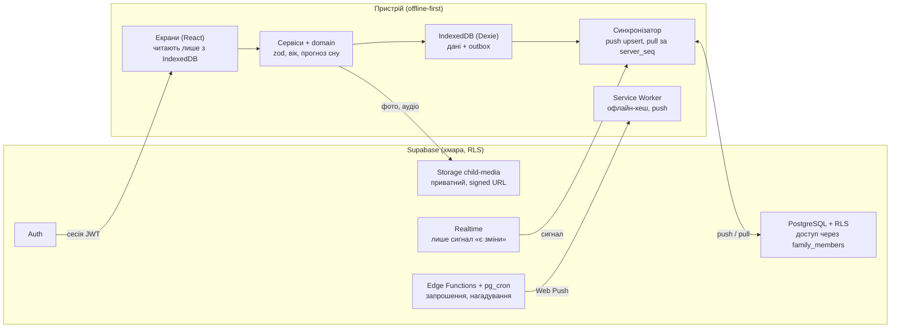

# LUMI — Фаза 0: технічний план

Nov 4, 2026 · @Антон

## Резюме

LUMI будуємо як offline-first PWA: усі дані спершу пишуться в IndexedDB на пристрої, а потім синхронізуються з Supabase, де доступ до кожної дитини закрито політиками RLS. Уся «розумна» логіка (вік, прогноз сну, перцентилі ВООЗ, рекомендації) — це чисті функції TypeScript без мережі й без AI API.

Ключові рішення:

- **Одне ядро, два способи запуску.** Бізнес-логіка лежить у `src/domain` і не залежить від React чи Supabase. Той самий код працює в артефакті-прев'ю і в справжньому застосунку.
- **Артефакт-прев'ю** (те, що ви бачитимете найближчим часом) — один HTML-файл на React + Tailwind. Дані зберігаються лише в браузері (IndexedDB), без авторизації та хмари. Режим чітко позначено як «Локальний перегляд», щоб він не видавав себе за повний продукт.
- **Повний застосунок** — репозиторій Vite з SQL-міграціями Supabase, Auth, Storage, Realtime, Service Worker і Web Push. Розгортання на безкоштовних тарифах (Supabase Free + Cloudflare Pages або Vercel Hobby).
- **Медичні довідники версіоновані.** Календар щеплень, таблиці ВООЗ і етапи розвитку зберігаються з назвою джерела, версією та датою перевірки; їх можна оновити без зміни коду.
- **Ідентифікатори — UUIDv7, які генерує клієнт.** Так запис, створений без інтернету, отримує остаточний id одразу, і дублікати при повторній відправці неможливі.

Документ відповідає на 12 пунктів ТЗ у тому ж порядку. Після вашого погодження починаю Фазу 1.

## 1. Загальна архітектура

Застосунок складається з шести шарів. Кожен шар звертається лише до шарів нижче, тому UI ніколи не викликає Supabase напряму.

| Шар | Папка | Відповідальність | Залежить від |
| --- | --- | --- | --- |
| UI | `src/ui`, `src/features/*/ui` | Екрани, компоненти, анімації, теми | Hooks |
| Hooks / стан | `src/features/*/hooks` | Реактивне читання даних (`useLiveQuery` з Dexie), виклик сервісів | Services, Domain |
| Services | `src/features/*/service.ts` | Сценарії: «почати сон», «додати вимірювання»; валідація + запис у репозиторій + постановка в чергу синхронізації | Domain, Data |
| Domain | `src/domain` | Чисті функції: вік, тривалість, прогноз сну, аналіз денних снів, z-score ВООЗ, розклад щеплень. Без будь-яких імпортів React/Dexie/Supabase | Нічого (лише date-fns, zod) |
| Data | `src/data` | Локальна БД Dexie, репозиторії, черга змін (outbox), синхронізатор | Platform |
| Platform | `src/platform` | Клієнт Supabase, Service Worker, Web Push, аудіо, feature detection | Браузерні API |

Принципи:

1. **Offline-first.** UI читає тільки з IndexedDB. Мережа — це фоновий процес синхронізації, а не умова роботи екрана.
2. **Фічі як модулі.** Кожен розділ (сон, зростання, щеплення, ігри…) — окрема папка `src/features/<назва>` зі своїми ui, hooks, service і тестами. Новий модуль додається без переписування інших.
3. **Одна схема валідації на все.** Zod-схеми в `src/domain/schemas` перевіряють форми, локальний запис і відповіді сервера. Ті ж правила дублюються CHECK-обмеженнями в PostgreSQL.
4. **Безпека на рівні БД.** Фронтенд має лише публічний `anon`-ключ. Хто що бачить, вирішує RLS. Ключ `service_role` живе лише в Edge Functions.
5. **Жодних платних API.** Прогнози та рекомендації рахуються на пристрої; дані дитини не покидають ваш проєкт Supabase.

Додаткові бібліотеки понад стек ТЗ: `zod` (валідація), `react-router` (маршрути), `zustand` (легкий UI-стан: активна дитина, тема), `uuidv7`, `jspdf` (PDF на пристрої), `vitest` + `@testing-library/react` + `playwright` (тести). Усі безкоштовні з ліцензією MIT або сумісною.

## 2. Структура папок і файлів

Кожен модуль має однакову внутрішню будову (`ui/`, `hooks/`, `service.ts`, `*.test.ts`), тому нижче вона розписана повністю лише для `sleep`.

```
lumi/
├─ .env.example                  # VITE_SUPABASE_URL, VITE_SUPABASE_ANON_KEY, VITE_VAPID_PUBLIC_KEY
├─ index.html
├─ vite.config.ts                # vite-plugin-pwa (injectManifest), аліас @/
├─ tailwind.config.ts            # токени з src/ui/tokens.ts
├─ tsconfig.json                 # strict: true
├─ playwright.config.ts
├─ public/
│  ├─ icons/                     # 192, 512, maskable, apple-touch-icon 180
│  ├─ splash/                    # apple-touch-startup-image під основні iPhone
│  └─ audio/                     # лише записи природи (дощ, хвилі, ліс) у .m4a/.ogg, CC0
├─ supabase/
│  ├─ config.toml
│  ├─ migrations/
│  │  ├─ 0001_extensions_and_helpers.sql
│  │  ├─ 0002_core_profiles_children_family.sql
│  │  ├─ 0003_sleep.sql
│  │  ├─ 0004_health.sql          # вимірювання, щеплення, лікарі, ліки
│  │  ├─ 0005_development.sql
│  │  ├─ 0006_reminders_push_notes.sql
│  │  ├─ 0007_rls_policies.sql
│  │  └─ 0008_storage_buckets.sql
│  ├─ seed/
│  │  ├─ vaccination_schedule_ua_2026.sql
│  │  └─ development_milestones_cdc_2022.sql
│  ├─ tests/                     # pgTAP: тести RLS
│  │  └─ rls_family_access.test.sql
│  └─ functions/                 # Edge Functions (Deno)
│     ├─ send-invitation/        # лист запрошення
│     ├─ accept-invitation/
│     ├─ dispatch-reminders/     # Web Push за розкладом (pg_cron)
│     └─ delete-account/         # повне видалення даних
├─ src/
│  ├─ main.tsx
│  ├─ app/
│  │  ├─ App.tsx
│  │  ├─ router.tsx               # захищені маршрути
│  │  ├─ providers.tsx            # тема, сесія, активна дитина, toast
│  │  └─ sw.ts                    # Service Worker (Workbox + push)
│  ├─ domain/                     # чиста логіка, 100% покриття тестами
│  │  ├─ types.ts
│  │  ├─ schemas/                 # zod: child, sleep, measurement, vaccination…
│  │  ├─ age/age.ts               # роки/місяці/дні, тижні, вік у днях
│  │  ├─ sleep/
│  │  │  ├─ sessions.ts           # тривалість, розрізання по добах, перетини
│  │  │  ├─ stats.ts              # середні, вікна неспання, порівняння тижнів
│  │  │  ├─ prior.ts              # вікові стартові діапазони
│  │  │  ├─ predict.ts            # прогноз наступного сну
│  │  │  ├─ napTransition.ts      # аналіз кількості денних снів
│  │  │  └─ tips.ts
│  │  ├─ growth/
│  │  │  ├─ lms.ts                # z-score та перцентиль за LMS
│  │  │  └─ who-tables/           # JSON з офіційних таблиць ВООЗ (з версією)
│  │  ├─ vaccination/schedule.ts  # планові дати від дати народження
│  │  ├─ reminders/rules.ts        # за 7/3/1/0 днів
│  │  ├─ development/              # добір щоденних активностей, складність ігор
│  │  └─ reports/monthlySummary.ts
│  ├─ data/
│  │  ├─ db.ts                    # Dexie: таблиці, індекси, версії схеми
│  │  ├─ repositories/            # один файл на сутність
│  │  ├─ outbox.ts                # черга локальних змін
│  │  └─ sync/
│  │     ├─ push.ts               # outbox → Supabase
│  │     ├─ pull.ts               # Supabase → Dexie за курсором
│  │     ├─ realtime.ts           # підписка на зміни сім'ї
│  │     ├─ conflicts.ts          # правила злиття
│  │     └─ status.ts             # синхронізовано / очікує / помилка
│  ├─ platform/
│  │  ├─ supabase.ts
│  │  ├─ auth.ts
│  │  ├─ push.ts                  # підписка Web Push + feature detection
│  │  ├─ audio/engine.ts          # Web Audio: генерація шумів, мікшер, затухання
│  │  ├─ speech.ts                # озвучення назв (записи + Web Speech як запасний)
│  │  └─ capabilities.ts          # standalone, iOS, push, wake lock, media session
│  ├─ features/
│  │  ├─ auth/  onboarding/  children/  home/
│  │  ├─ sleep/
│  │  │  ├─ ui/  SleepScreen.tsx  SleepTimerCard.tsx  SleepEntrySheet.tsx
│  │  │  │       DayTimeline.tsx  PredictionCard.tsx  NapAdviceCard.tsx
│  │  │  ├─ hooks/ useActiveSleep.ts  useSleepDay.ts  usePrediction.ts
│  │  │  ├─ service.ts
│  │  │  └─ service.test.ts
│  │  ├─ sounds/  stats/  growth/  vaccinations/  doctors/  medications/
│  │  ├─ calendar/  reminders/  development/  games/  diary/  family/
│  │  └─ settings/  export/  privacy/
│  ├─ ui/
│  │  ├─ tokens.ts                # кольори, відступи, радіуси, тіні
│  │  ├─ primitives/              # GlassCard, Button, Sheet, Toast, Skeleton…
│  │  └─ layout/                  # AppShell, TabBar, SafeArea, Header
│  └─ i18n/uk.ts                  # усі тексти інтерфейсу
└─ e2e/                          # Playwright: iPhone, Android, desktop
```

## 3. Схема бази даних

Схема має 24 таблиці: усі 23 з ТЗ і одна додана — `health_logs` для температури та самопочуття (швидка дія з головного екрана). Міграцію вже написано (файл `0001_lumi_schema.sql`, 793 рядки) і прогнано на PostgreSQL 16 із заглушками `auth` та `storage`; 26 сценаріїв доступу та синхронізації дали очікуваний результат (див. розділ 12).

### Спільні правила

- **Кожна таблиця з даними дитини** має `child_id` (FK → `children`, `on delete cascade`) і однакові службові колонки: `id uuid`, `created_by`, `updated_by`, `client_updated_at`, `created_at`, `updated_at`, `server_seq bigint`, `version int`, `deleted_at`.
- **Сервер сам ставить** `updated_at`, `server_seq` (глобальна послідовність — курсор для pull), `version` і `updated_by`. Клієнт ці поля підробити не може.
- **Старі дані не перезаписують нові.** Тригер відкидає оновлення, якщо його `client_updated_at` не новіший за збережений.
- **`child_id` незмінний** — запис неможливо «перенести» до чужої дитини.
- **Soft delete:** члени сім'ї видаляють через `deleted_at`; відновлення = `deleted_at = null`. Жорстке видалення — лише власник або Edge Function «Видалити всі дані». Сміття очищається через 30 днів (pg\_cron).
- **Одиниці:** вага в грамах, довжини в міліметрах (цілі числа, без похибок), час — `timestamptz` в UTC, дати — `date`.

### Таблиці

| Таблиця | Призначення | Ключові поля | Обмеження та індекси | Доступ (RLS) |
| --- | --- | --- | --- | --- |
| `profiles` | Профіль користувача | `id` = `auth.users.id`, `display_name`, `timezone` | Створюється тригером під час реєстрації | Свій; імена членів своєї сім'ї — читання |
| `user_settings` | Тема, активна дитина, сповіщення, останній звук | `theme` (system/light/dark), `notifications jsonb` | PK `user_id` | Свій |
| `children` | Профіль дитини | `name`, `birth_date`, `birth_time`, `birth_timezone`, `sex`, `gestational_age_weeks`, `photo_path` | Довжина імені 1–60; тригер додає творця як `owner` | Члени сім'ї; видалення — лише власник |
| `family_members` | Хто має доступ до дитини | PK (`child_id`, `user_id`), `role` owner/member | Один owner на дитину (частковий unique) | Читання — члени; додавання — лише тригер/функція; видалення member — власник або сам учасник |
| `family_invitations` | Запрошення другого з батьків | `email citext`, `token_hash` (sha256), `status`, `expires_at` (+7 днів) | Одне pending на email+дитину | Лише власник; прийняття — RPC `accept_family_invitation(token)` із перевіркою email |
| `sleep_sessions` | Сон | `kind` nap/night, `started_at`, `ended_at` (null = триває), `source`, `wake_reason`, `comment` | Кінець > початок; ≤ 20 год; **один активний сон на дитину**; індекс (`child_id`, `started_at desc`) | Члени сім'ї |
| `sleep_settings` | Типовий час відбою/підйому, бажана кількість снів | PK `child_id` | Снів 0–6 | Члени сім'ї |
| `sleep_predictions` | Журнал прогнозів для пояснень і оцінки точності | `algorithm_version`, вікно, `confidence`, `reasons jsonb`, `actual_session_id` | Вікно: кінець ≥ початок | Члени сім'ї |
| `growth_measurements` | Вага, зріст, окружність голови | `measured_on`, `weight_g`, `length_mm`, `head_mm`, `position` lying/standing | Хоча б одне значення; фізіологічні межі | Члени сім'ї |
| `health_logs` | Температура, самопочуття | `kind`, `temperature_c numeric(3,1)` | 34,0–43,0 °C | Члени сім'ї |
| `vaccination_schedule` | Довідник офіційного календаря | `schedule_code`, `source_url`, `effective_from`, `verified_at`, `antigen_code`, `dose_number`, `age_days`/`age_months` | Unique (календар, антиген, доза) | Читання для всіх автентифікованих |
| `vaccinations` | Щеплення дитини | `schedule_item_id`, `planned_date`, `actual_date`, `status`, `adjusted_by_doctor`, `manufacturer`, `lot_number` | `done` → обов'язкова фактична дата; один запис на пункт календаря | Члени сім'ї |
| `doctor_appointments` | Записи до лікаря | `doctor_name`, `specialty`, `starts_at`, `address`, `phone`, `reason`, `outcome` | Обмеження довжини | Члени сім'ї |
| `medication_plans` | Призначення лікаря | `prescribed_dosage` (**текст як є**), `start_date`, `end_date`, `schedule_times time[]` | Кінець ≥ початок | Члени сім'ї |
| `medication_logs` | Історія прийомів | `plan_id`, `taken_at`, `dosage_text` | Індекс на FK | Члени сім'ї |
| `reminders` | Нагадування | `entity_type`, `entity_id`, `fire_at`, `offset_days`, `sent_at` | Частковий індекс «ще не відправлені» | Члени сім'ї |
| `development_milestones` | Довідник етапів розвитку | `source_code`, `checklist_age_months`, `domain`, `title_uk` | Вік 0–60 міс. | Читання |
| `development_activities` | Довідник активностей | `area`, віковий діапазон, `duration_min`, ціль, предмети, інструкція, спрощення/ускладнення | `max ≥ min` | Читання |
| `completed_activities` | Виконані / відкладені / обрані | `activity_id`, `status`, `for_date`, `is_favorite`, `note` | Індекс на FK | Члени сім'ї |
| `achievements` | Досягнення, перший зуб, перші кроки | `milestone_id`, `kind`, `achieved_on`, `media_path` | — | Члени сім'ї |
| `notes` | Нотатки, щоденник, моменти, перші слова | `kind`, `occurred_at`, `body`, `media_paths text[]` | Текст ≤ 10 000 симв. | Члени сім'ї |
| `audio_favorites` | Обрані звуки та мікси | `sounds jsonb` | Unique (`user_id`, `sounds`) | Свій |
| `push_subscriptions` | Підписки Web Push | `endpoint` unique, `p256dh`, `auth_secret` | — | Свій |
| `sync_metadata` | Пристрої та остання синхронізація | PK (`user_id`, `device_id`), `last_pull_seq`, `last_error` | — | Свій |

### RLS: як захищено дані дитини

Усі політики таблиць дитини побудовані на одній перевірці, яка рахується один раз на запит:

```sql
create policy sleep_sessions_select on public.sleep_sessions for select to authenticated
  using (child_id in (select private.my_child_ids()));
```

`private.my_child_ids()` — функція `security definer` у схемі `private`, яка не відкрита через API. Вона повертає дітей, у сім'ї яких є `auth.uid()`. Insert додатково вимагає `created_by = auth.uid()`. Роль `anon` не має жодних прав на таблиці.

**Фото та аудіо** лежать у приватному бакеті `child-media` за шляхом `<child_id>/<uuid>.<ext>` (≤ 10 МБ; JPEG, PNG, WebP, HEIC, M4A, WebM, OGG). Політики `storage.objects` перевіряють першу папку шляху через ту саму `my_child_ids()`. Показ — лише через signed URL на 1 годину.

## 4. Взаємодія frontend, Supabase і IndexedDB



Екрани ніколи не чекають на мережу: вони читають і пишуть IndexedDB, а синхронізатор у фоні обмінюється змінами з PostgreSQL. Realtime лише повідомляє про зміни від іншого члена сім'ї, тому всі дані проходять через RLS. Ключ `service_role` існує лише в Edge Functions; у фронтенді — тільки `anon`-ключ з `.env`.

## 5. План синхронізації

Синхронізація — це два незалежні потоки: **push** (локальна черга → Supabase) і **pull** (Supabase → IndexedDB за курсором `server_seq`). Вони запускаються під час старту, після кожного локального запису (з затримкою 1,5 с), за подією `online`, коли вкладка стає видимою, і за сигналом Realtime від іншого члена сім'ї.

### Запис на пристрої (одна транзакція Dexie)

1. Сервіс валідує дані zod-схемою.
2. Новий запис отримує UUIDv7 і `client_updated_at = now()`.
3. Рядок пишеться в таблицю Dexie зі станом `_sync: 'pending'`.
4. У `outbox` додається операція `{ id, table, rowId, op: 'upsert', attempts: 0 }`. Кілька змін одного рядка зливаються в одну операцію: відправляється останній стан рядка.
5. UI оновлюється одразу через `useLiveQuery`, не чекаючи мережі.

### Push

- Операції відправляються пачками до 100 рядків на таблицю як `upsert` за `id`. Повторна відправка того самого `id` не створить дубліката.
- Видалення = upsert із `deleted_at`. Жорстких delete через синхронізацію немає.
- Порядок таблиць враховує FK: `children` → `medication_plans` → `medication_logs` і так далі.
- **Помилки мережі та 5xx** → повтор з експоненційною затримкою 2, 4, 8 … до 300 с із випадковим розкидом.
- **401** → оновити сесію та повторити один раз.
- **4xx контракту** (RLS, CHECK, unique) → рядок позначається `_sync: 'error'` із текстом причини і більше не повторюється. Користувач бачить його в «Стан синхронізації» і може виправити або видалити.
- Успішна відправка → операція видаляється з outbox; рядок переходить у `synced`, коли pull поверне його з `server_seq`.

### Pull

- Для кожної таблиці: `select * where server_seq > :cursor order by server_seq limit 500`, доки є рядки. RLS сам обмежує вибірку дітьми користувача.
- Курсор зберігається локально для кожної таблиці. Щоб не втратити рядки з транзакцій, які зафіксувались не за порядком, запит бере невелике перекриття (останні 200 номерів). Злиття ідемпотентне, тому повтори безпечні.
- Коли користувача виключили з сім'ї, він більше не отримує рядків цієї дитини. Клієнт порівнює список `family_members` з локальним і очищає локальні дані дитини, до якої доступу вже немає.
- Realtime не передає даних, лише сигнал «є зміни» (канал `child:<id>`, broadcast із тригера). Далі спрацьовує звичайний pull. Так захист даних тримається лише на RLS, а не на правилах Realtime.

### Конфлікти

| Ситуація | Правило |
| --- | --- |
| Обоє батьків редагували один запис | Перемагає новіший `client_updated_at` (це перевіряє тригер БД). Стара версія зберігається локально в `conflicts` на 7 днів і показується підказкою «Запис змінено іншим учасником» |
| Два активні сни з двох телефонів офлайн | БД приймає перший, другий отримує unique-помилку. Клієнт показує «Сон уже записано з іншого пристрою» і пропонує об'єднати (раніший початок) або видалити свій |
| Запис видалено на одному пристрої і редаговано на іншому | Те саме правило новішої мітки; видалене можна відновити зі «Сміття» 30 днів |
| Годинник телефону відстає чи поспішає | Клієнт рахує зсув від серверного заголовка `Date` і коригує `client_updated_at`. Якщо зсув понад 5 хв, з'являється попередження |

### Статус для користувача

- **Синхронізовано** — outbox порожній, останній pull успішний; поруч показується час.
- **Очікує синхронізації** — в outbox є операції (показується їхня кількість) або немає мережі.
- **Помилка синхронізації** — є рядки `error` або понад 10 невдалих спроб підряд; натискання відкриває список із причинами.

На старті застосунок викликає `navigator.storage.persist()`, щоб браузер не очистив IndexedDB. До першої синхронізації застосунок попереджає, що дані зберігаються лише на цьому пристрої.

## 6. Структура навігації

Нижня панель має 5 вкладок; усе інше відкривається з них або з аватара дитини у верхньому лівому куті. Швидкі записи відкриваються аркушем знизу (bottom sheet), а не окремою сторінкою, щоб запис займав 1–2 дотики.

| Вкладка | Маршрут | Вкладені екрани та аркуші |
| --- | --- | --- |
| Головна | `/` | Швидкі дії (аркуші: сон, вага, зріст, температура, ліки, нотатка) · стрічка дня · «Що сьогодні важливо» · статус синхронізації `/sync` |
| Сон | `/sleep` | День / тиждень / місяць · запис `/sleep/:id` · прогноз і його причини · аналіз денних снів · поради `/sleep/tips` · білий шум `/sounds` (міні-плеєр залишається над панеллю на всіх екранах) |
| Статистика | `/stats` | Періоди 7 д / 30 д / 3 м / 6 м / весь · сон · зростання `/growth` (вага, зріст, голова, перцентилі) · «Підсумок місяця» `/stats/month/:ym` · експорт PDF/CSV `/export` |
| Розвиток | `/dev` | Щоденні активності · етапи розвитку `/dev/milestones` · ігри `/play/*` (тварини, кольори і форми, перші слова, пам'ять і логіка) · щоденник і моменти `/diary` |
| Календар | `/calendar` | Місяць / тиждень / список · щеплення `/vaccinations` · лікарі `/doctors` · ліки `/medications` · нагадування `/reminders` |

**З аватара дитини:** перемикання між дітьми · профіль дитини `/child/:id` · сім'я і запрошення `/family` · налаштування `/settings` (тема, сповіщення, синхронізація) · приватність `/privacy` (експорт даних, видалення акаунта) · сміття `/trash`.

**Поза авторизацією:** `/auth/sign-in`, `/auth/sign-up`, `/auth/reset`, `/auth/update-password`, `/invite/:token` (зберігає токен і веде на вхід), `/onboarding` (перша дитина, 3 кроки). Усі інші маршрути захищені: без сесії ведуть на вхід, без дитини — на onboarding.

**Дитячий режим ігор.** `/play/*` відкривається на повний екран без нижньої панелі. Вийти можна довгим натисканням хрестика (1,5 с), щоб дитина випадково не потрапила в дані.

## 7. Дизайн-система

Стиль — «тихе скло»: молочний фон, напівпрозорі картки з розмиттям, один пастельний акцент на кожен модуль. Колір означає розділ, а не декор: сон завжди лавандовий, зростання — м'ятне і так далі. Токени лежать у `src/ui/tokens.ts` і передаються в Tailwind як CSS-змінні, тому тема перемикається без перезавантаження.

### Кольори

| Токен | Світла | Темна | Нічний режим | Де |
| --- | --- | --- | --- | --- |
| `bg` | #FAF7F2 | #0E1220 | #07090F | Фон екрана |
| `surface` | rgba(255,255,255,0.72) + blur 24 | rgba(26,32,51,0.64) + blur 24 | rgba(18,20,28,0.8), без blur | Картки |
| `surface-border` | rgba(20,24,40,0.06) | rgba(255,255,255,0.08) | rgba(255,255,255,0.05) | Рамка скла 1 px |
| `text-primary` | #1C1E26 (15,6:1) | #F2F3F7 (16,8:1) | #E6DCCB (14,7:1) | Основний текст |
| `text-secondary` | #5B5F6E (5,9:1) | #A9AEC0 (8,4:1) | #9C9284 (6,5:1) | Підписи |
| `text-tertiary` | #80838F (3,5:1) | #6F758A | #6E665A | Лише текст ≥ 18 px або декор |
| `accent` (кнопки) | #5B57D9, білий текст 5,5:1 | #A6A3FF, темний текст 8,3:1 | #F2A77E (10:1) | Головна дія |
| `sleep` | #8B87F0 / фон чіпа #E9E8FD | #A6A3FF | #F2A77E | Сон, шуми |
| `growth` | #5FB8A5 / #DDF2EC, текст #1F5E51 | #7FD3BF | — | Зростання |
| `health` | #F08A7E / #FDE5E1, текст #8A2F25 | #FF9E92 | — | Щеплення, ліки, температура |
| `develop` | #F2B65A / #FDF0D9, текст #7A5208 | #FFC774 | — | Розвиток, ігри |
| `calendar` | #6AA8E8 / #E0EDFB, текст #1F4E80 | #8CC2FF | — | Події |
| `success` / `warning` / `danger` | #23865B / #B7791F / #C9423E | #5BD19A / #F5C065 / #FF7A72 | — | Статуси, помилки |

**Нічний режим** вмикається сам, коли сон активний або зараз між 21:00 і 06:00 (можна вимкнути). На екрані залишається таймер і одна велика кнопка, фон майже чорний, акцент теплий бурштиновий (менше синього світла), анімації вимкнені. Відсотки контрасту в таблиці пораховано за WCAG 2.1 відносно `bg`.

### Типографіка

Шрифт: системний `-apple-system, "SF Pro Text"` на iOS і `Inter` (локальний WOFF2 із кирилицею, \~90 КБ) на інших платформах. Цифри в таймерах і таблицях — `tabular-nums`. Розміри в rem, тому системне збільшення шрифту працює.

| Стиль | Розмір / рядок, px | Насиченість | Де |
| --- | --- | --- | --- |
| `display-timer` | 56 / 60 | 600, rounded | Активний сон |
| `large-title` | 34 / 41 | 700 | Заголовок вкладки |
| `title-1` | 28 / 34 | 700 | Ім'я дитини |
| `title-2` | 22 / 28 | 600 | Заголовок картки |
| `headline` | 17 / 22 | 600 | Пункти списку, кнопки |
| `body` | 17 / 24 | 400 | Текст |
| `subhead` | 15 / 20 | 400 | Другий рядок |
| `footnote` | 13 / 18 | 400 | Підписи, джерела |
| `caption` | 12 / 16 | 500 | Осі графіків |

### Відступи, радіуси, тіні, рух

- **Відступи** (крок 4): 4, 8, 12, 16, 20, 24, 32, 40, 48. Поля екрана 20; внутрішні поля картки 20; проміжок між картками 12; між секціями 32.
- **Радіуси:** чіп 10 · поле введення і кнопка 16 · картка 24 · аркуш знизу 32 (верхні кути) · кругла кнопка сну 9999.
- **Тіні (світла тема):** `0 1px 2px rgba(20,24,40,.04), 0 8px 24px rgba(20,24,40,.06)`; аркуш `0 -8px 40px rgba(20,24,40,.12)`. У темній темі тіней немає, глибину дає рамка `surface-border` і світлий верхній край 1 px.
- **Розмиття:** `backdrop-filter: blur(24px) saturate(160%)`. Якщо браузер його не підтримує або увімкнено «зменшити прозорість», картка стає суцільною (біла або #1A2033).
- **Рух:** 120 мс — натискання, 200 мс — поява, 320 мс — аркуш; spring stiffness 400, damping 34. За `prefers-reduced-motion` анімації замінюються простим згасанням.
- **Розміри для дотику:** мінімум 44×44; кнопки швидких дій 56 заввишки; головна кнопка «Почати / завершити сон» — круг 96 у нижній третині екрана, де її дістає великий палець.
- **Safe area:** `padding-bottom: calc(env(safe-area-inset-bottom) + 8px)` для нижньої панелі (висота 56 + inset), `viewport-fit=cover`, заголовок з `env(safe-area-inset-top)`.

## 8. Основні компоненти

Компоненти поділені на три рівні: примітиви без бізнес-логіки, спільні блоки та компоненти модулів. Примітиви приймають лише props і не знають про Dexie чи Supabase.

| Рівень | Компонент | Призначення |
| --- | --- | --- |
| Примітив | `GlassCard` | Картка зі склом, варіанти `default`, `accent`, `solid` |
| Примітив | `Button`, `IconButton`, `QuickActionButton` | Розміри 44 / 56; стани loading, disabled |
| Примітив | `Sheet` | Аркуш знизу з жестом закриття та фокус-пасткою |
| Примітив | `TextField`, `NumberField`, `DateField`, `TimeField`, `DurationPicker` | Поля з українськими помилками zod; числа з комою (5,2 кг) |
| Примітив | `SegmentedControl`, `Toggle`, `Chip` | День / тиждень / місяць, фільтри |
| Примітив | `Toast`, `ConfirmDialog` | Повідомлення і підтвердження небезпечних дій; після видалення — «Скасувати» 5 с |
| Примітив | `Skeleton`, `EmptyState`, `ErrorState` | Стани завантаження, порожнечі та помилки з дією |
| Каркас | `AppShell`, `TabBar`, `SafeArea`, `ScreenHeader` | Навігація, safe-area, великий заголовок, що стискається при прокручуванні |
| Спільний | `ChildSwitcher`, `ChildAvatar`, `AgeLabel` | Перемикання дітей, фото з signed URL, вік «1 рік, 3 місяці, 12 днів» |
| Спільний | `SyncBadge`, `OfflineBanner` | Статус синхронізації та мережі |
| Спільний | `DayTimeline` | Стрічка подій дня: сон, ліки, вимірювання, заняття |
| Спільний | `SourceNote`, `MedicalDisclaimer` | Джерело, версія і дата перевірки довідкових даних; «Узгодьте з педіатром» |
| Графіки | `Sleep24hRing`, `SleepWeekBars`, `SleepTrendLine` | Кольорова шкала доби, смуги за тиждень, тренд (Recharts) |
| Графіки | `GrowthChart` | Точки дитини на кривих P3–P15–P50–P85–P97 ВООЗ; без кривих, коли розрахунок неможливий |
| Сон | `SleepToggleButton`, `ActiveSleepTimer`, `SleepEntrySheet` | Старт / стоп за 1 дотик; таймер з `started_at` (не лічильник), ручне введення і редагування |
| Сон | `PredictionCard`, `NapAdviceCard`, `SleepTipCard` | Прогноз з діапазоном, впевненістю та причинами |
| Звуки | `SoundGrid`, `MiniPlayer`, `MixerSheet`, `SleepTimerPicker`, `SafetyNotice` | Вибір звуку, мікшер двох доріжок, таймер 15–90 хв, попередження про безпеку |
| Здоров'я | `MeasurementSheet`, `VaccinationList`, `VaccinationSheet`, `AppointmentSheet`, `MedicationPlanSheet`, `ReminderOffsets` | Форми та списки медичного календаря |
| Календар | `MonthGrid`, `WeekStrip`, `EventList` | Три види календаря |
| Розвиток | `ActivityCard`, `MilestoneChecklist` | Щоденні активності; етапи без оцінок «відстає» |
| Ігри | `GameShell`, `TapCard`, `ChoiceGrid`, `MatchPairs`, `DragSort`, `AudioPrompt` | Спільний рушій ігор: великі зони дотику, озвучення, захист від випадкового виходу |
| Сім'я | `MemberList`, `InviteSheet` | Учасники, запрошення, відкликання |

Кожен примітив має відчутні підписи для VoiceOver, видимий фокус для клавіатури та тест доступності (axe).

## 9. Алгоритм прогнозування сну

Прогноз стартує з вікових орієнтирів і з кожним днем дедалі більше спирається на власні записи дитини за 14 днів. Версія `sleep-predict@1`; це чиста функція `predictNextSleep(input, now)` у `src/domain/sleep/predict.ts` без мережі та AI.

**Чесне застереження.** Для загальної тривалості сну є доказовий консенсус AASM (розділ 10). Для «вікон неспання» порівнянної доказової бази немає: це розповсюджена практична евристика. Тому вікова таблиця нижче — лише стартова точка з низькою вагою. Вона показується як «орієнтир», а не як норма, і до 4 місяців прогноз має максимум середню впевненість: AASM не дає рекомендацій для цього віку через дуже широкий діапазон норми.

### Крок 0. Вхідні дані

- Вік у днях; для недоношених (< 37 тижнів) до 24 місяців береться скоригований вік.
- Усі завершені сни за 14 днів, активний сон, `sleep_settings`, дні з температурою ≥ 37,5 °C (з `health_logs`).
- Доба дитини починається з ранкового пробудження, а не з 00:00. У кожному дні вікна неспання нумеруються за позицією: WW1 (до 1-го сну), WW2, …, WW-last (до нічного сну).

### Крок 1. Віковий орієнтир (prior)

| Вік | Вікно неспання | Денних снів | Сон за 24 год (AASM) |
| --- | --- | --- | --- |
| 0–6 тиж | 45–60 хв | 4–8 | не визначено |
| 6–12 тиж | 60–90 хв | 4–5 | не визначено |
| 3–4 міс | 75–120 хв | 3–5 | 12–16 год (з 4 міс) |
| 5–6 міс | 2–2,5 год | 3 | 12–16 год |
| 7–8 міс | 2,5–3 год | 2–3 | 12–16 год |
| 9–12 міс | 3–4 год | 2 | 12–16 год |
| 13–18 міс | 4–5,5 год | 1–2 | 11–14 год |
| 19–36 міс | 5–6,5 год | 1 | 11–14 год (група AASM «1–2 роки») |
| 3–5 років | 6–12 год | 0–1 | 10–13 год |

У коді таблиця задана по днях і значення плавно інтерполюються, щоб не було стрибків на межі місяців. Перед релізом цю таблицю треба показати педіатру.

### Крок 2. Особиста статистика дитини

Для потрібної позиції (наприклад, WW2) беруться всі такі вікна за 14 днів. Викидаються:

- вікна коротші за 0,5× або довші за 2× від вікового центру (ймовірна помилка запису);
- дні, коли дитина хворіла (температура), та дні, які батьки позначили як «нетиповий день»;
- дні з дірками: ті, де записано менше снів, ніж зазвичай, і є прогалини понад 2× вікна.

З решти рахується **зважена медіана** (вага спадає вдвічі кожні 4 дні) і **міжквартильний розмах** IQR. Медіана стійка до одного незвичного дня, а ваги дають адаптацію за 3–5 днів, коли режим справді змінюється.

### Крок 3. Змішування

```
n  = ефективна кількість спостережень (сума ваг)
w  = min(0.9, n / (n + 4))          // 0 спостережень → лише орієнтир; 12 → 75% власних даних
WW = w · median_personal + (1 − w) · prior_center
```

### Крок 4. Поправки на сьогоднішній день

- **Короткий попередній сон** (< 0,6 від особистої медіани для цієї позиції) → вікно коротшає на 10%, але не більше ніж на 20 хв.
- **Довгий попередній сон** (> 1,4 від медіани) → вікно довшає на 5%, але не більше ніж на 15 хв.
- **Раннє ранкове пробудження** (на 60+ хв раніше за медіану) → WW1 коротшає на 10%.
- **Нічний сон.** Усереднюються два варіанти: «останнє пробудження + WW-last» і медіана часу відбою за 7 днів (або `typical_bedtime`). Якщо вони розходяться понад на 45 хв, з'являється підказка «День змістився: можливо, останній сон варто вкоротити».
- **Вибір типу наступного сну.** Якщо запланований денний сон разом із WW-last закінчується пізніше за типовий відбій + 30 хв, прогнозується нічний сон або короткий містковий сон із поясненням.

### Крок 5. Результат

- **Рекомендований час** = останнє пробудження + WW, округлене до 5 хв.
- **Діапазон** = ± max(10 хв, IQR/2), але не більше ±45 хв. Без власних даних — увесь віковий діапазон.
- **Початок підготовки** = початок діапазону мінус час ритуалу (за замовчуванням 10 хв для денного сну, 30 хв для нічного; налаштовується).
- **Рекомендована тривалість** = зважена медіана снів цієї позиції, змішана з орієнтиром тим самим способом.
- **Впевненість:**
  - `insufficient_data` — немає запису останнього пробудження або за останні 18 год не записано жодного сну. Тоді картка пише «Щоб порахувати прогноз, запишіть останнє пробудження» і числа не показує.
  - `low` — менше ніж 5 спостережень для цієї позиції.
  - `medium` — 5–9 спостережень або IQR > 30 хв.
  - `high` — ≥10 спостережень, IQR ≤ 30 хв, записи є щонайменше за 5 із 7 останніх днів, вік ≥ 4 місяці.
- **Причини** — список кодів (`based_on_last_wake`, `personal_ww_12_obs`, `short_prev_nap`, `bedtime_anchor`, `age_prior_only`…), які UI перекладає українською. Наприклад: «Наступний сон орієнтовно о 14:30–15:00. Враховано пробудження о 12:10, 12 схожих вікон за 2 тижні (типово 2 год 35 хв) і короткий попередній сон».

### Крок 6. Самоперевірка

Кожен показаний прогноз зберігається в `sleep_predictions`. Після фактичного сну прогноз прив'язується до нього через `actual_session_id`. У розділі «Як працює прогноз» батьки бачать середню похибку за 14 днів і частку снів, що почалися в межах діапазону. Ці ж цифри покажуть, чи потрібне налаштування алгоритму у версії 2.

### Аналіз кількості денних снів (`napTransition.ts`)

Порівнюються останні 7 днів і попередні 7. День має сигнал, якщо виконана хоча б одна умова:

| Рекомендація | Сигнали дня | Вікове вікно |
| --- | --- | --- |
| «Можливо, готова до меншої кількості снів» | Останній сон почався на 30+ хв пізніше за прогноз або пропущений; відбій змістився на 30+ хв пізніше медіани; нічний сон коротший на 45+ хв | 3→2: 6–10 міс; 2→1: 12–20 міс; 1→0: від 30 міс |
| «Можливо, потрібен додатковий сон» | Загальний сон за добу нижчий за нижню межу AASM; WW-last > 1,3× орієнтиру | До 18 міс |
| «Можливо, варто змінити час першого сну» | 1-й сон коротший за 0,6 медіани при WW1 нижче орієнтиру | До 24 міс |
| «Другий сон зміщується занадто пізно» | Кінець останнього сну + WW-last > типовий відбій + 30 хв | Усі |
| «Можливо, варто переглянути час відбою» | Розкид часу відбою > 60 хв за тиждень або стабільний зсув на 45+ хв | Усі |

**Поріг показу:** сигнал є щонайменше в 5 із 7 останніх днів, записи є за щонайменше 10 з 14 днів, дні хвороби не враховуються. Один незвичний день ніколи не запускає рекомендацію. Картка показує графік тенденції та пропонує поступовий перехід. Після переходу алгоритм 7 днів не пропонує зворотної зміни, а поради не містять діагнозів.

## 10. Офіційні джерела даних

Усі медичні та розвивальні довідники завантажуються з назвою джерела, посиланням, версією та датою перевірки. Усе це видно в інтерфейсі через `SourceNote`.

| Дані | Джерело | Версія / статус | Як використовуємо |
| --- | --- | --- | --- |
| Календар щеплень | Наказ МОЗ України від 16.09.2011 № 595 зі змінами наказу [від 05.03.2025 № 396](https://moz.gov.ua/uk/decrees/nakaz-moz-ukrayini-vid-05-03-2025-396-pro-vnesennya-zmin-do-kalendarya-profilaktichnih-sheplen-v-ukrayini) | Чинний з 01.01.2026 | Сід `UA-MOZ-2026` у `vaccination_schedule` |
| Норми загального сну | [AASM Consensus, Paruthi et al., J Clin Sleep Med 2016;12(6):785–786](https://pubmed.ncbi.nlm.nih.gov/27250809/) | 2016, схвалено AAP | Орієнтир загального сну за 24 год, аналіз денних снів |
| Безпечний сон | AAP, Sleep-Related Infant Deaths: Updated 2022 Recommendations (Moon et al., Pediatrics 2022) | 2022 | Поради щодо сну та ритуалу |
| Гучність білого шуму | Hugh et al., *Infant Sleep Machines and Hazardous Sound Pressure Levels*, Pediatrics 2014 | 2014 | Попередження: низька гучність, пристрій далеко від ліжечка, не в ліжечку; обмеження гучності повзунка за замовчуванням |
| Перцентилі фізичного розвитку | [WHO Child Growth Standards](https://www.who.int/tools/child-growth-standards): довжина/зріст і вага для віку (2006), окружність голови (2007) | LMS-таблиці по днях, 0–1856 днів | JSON у `who-tables/`, формула LMS (див. нижче); звірка з [CDC-дзеркалом](https://cdc.gov/growthcharts/who-data-files.htm) у тестах |
| Етапи розвитку | CDC «Learn the Signs. Act Early.», переглянуті разом із AAP; [Zubler et al., Pediatrics 2022;149(3):e2021052138](https://www.aafp.org/afp/2022/1000/editorial-cdc-developmental-milestone-checklist) | 2022: чек-листи на 2, 4, 6, 9, 12, 15, 18, 24, 30, 36, 48, 60 міс | Сід `CDC-LTSAE-2022`, власний український переклад |
| Вікна великих моторних навичок | WHO Motor Development Study (MGRS), Acta Paediatrica Suppl. 2006 | 2006, 6 навичок | Доповнення до моторних етапів (сидіння, повзання, ходьба) |
| Звуки | Шуми (білий, рожевий, коричневий, вентилятор, серцебиття) генеруються в браузері через Web Audio; записи природи та тварин — лише з ліцензією CC0 | Реєстр ліцензій `public/audio/LICENSES.md` | Жодних зовнішніх URL; файли кешуються для роботи офлайн |
| Озвучення слів | Власні записи українською (запише людина); до того — Web Speech API з голосом `uk-UA`, якщо він є на пристрої | — | Feature detection; без голосу назва показується текстом |

### Календар щеплень з 01.01.2026, від народження до 6 років (чернетка для сіду)

| Вік | Щеплення |
| --- | --- |
| 1-а доба | Гепатит B, «нульова доза» — лише за показаннями (наприклад, мати HBsAg-позитивна) |
| Перші дні життя | Туберкульоз (БЦЖ) |
| 2 міс | Дифтерія, правець, кашлюк + поліомієліт (ІПВ) + Hib + гепатит B — 1-а доза (комбінована вакцина) |
| 4 міс | Те саме — 2-а доза |
| 6 міс | Те саме — 3-я доза |
| 12 міс | Кір, паротит, краснуха (КПК) — 1-а доза |
| 18 міс | Дифтерія, правець, кашлюк + ІПВ + Hib + гепатит B — 4-а доза |
| 4 роки | КПК — 2-а доза (раніше було в 6 років) |
| 6 років | Дифтерія і правець (АДП) + ІПВ — 5-а доза |

Таблицю зібрано з [vaccine.org.ua](https://vaccine.org.ua/vakczynacziya-v-ukrayini/vaccinationua-calendar/), [medical-plus.ua](https://www.medical-plus.ua/kalendar-shcheplen/), [Телеграфу](https://news.telegraf.com.ua/ukr/ukraina/2025-12-23/5928785-noviy-kalendar-shcheplen-v-ukraini-shcho-zminitsya-z-1-sichnya) та новин [МОЗ на kmu.gov.ua](https://www.kmu.gov.ua/news/z-2026-roku-v-ukraini-onovliuietsia-natsionalnyi-kalendar-profilaktychnykh-shcheplen-eksperty-detalno-poiasnyly-kliuchovi-zminy). Джерела розходяться в двох місцях, тому це чернетка:

- [ ] Звірити номер чинної редакції. Один сайт називає наказ № 1722 від 14.11.2025, інші — № 396 від 05.03.2025.
- [ ] Звірити час 4-ї дози Hib: у більшості джерел 18 міс, в одному 12 міс.
- [ ] Звірити добу БЦЖ та перехідні положення для дітей, щеплених за старим календарем.

Рада та міністерство блокують автоматичне читання сайту, тому текст наказу на zakon.rada.gov.ua треба звірити вручну або прикласти PDF. У застосунку таблиця завжди показується з джерелом, датою актуалізації і приміткою «Індивідуальний графік узгодьте з педіатром». Пропущене щеплення не вважається втраченим: статус «Пропущено» пропонує обговорити доганяльну схему з лікарем.

### Розрахунок перцентилів ВООЗ

```latex
z = \frac{(X / M)^{L} - 1}{L \cdot S}
```

L, M, S беруться з таблиці за статтю та віком у днях; перцентиль — за нормальним розподілом від z. Правила методики: до 2 років довжина вимірюється лежачи. Якщо до 2 років міряли стоячи, додається 0,7 см; якщо після 2 років лежачи — віднімається 0,7 см. Для |z| > 3 у вазі застосовується скоригована формула ВООЗ. Застосунок показує перцентиль і динаміку, але не робить висновків за одним вимірюванням. Поза межами таблиць (після 1856 днів) показується звичайний графік.

## 11. Технічні ризики

Найбільше обмежень дає iOS: сповіщення, фонове аудіо та очищення сховища працюють гірше, ніж в Android. Тому ці механізми перевіряються на справжньому iPhone ще в Фазі 1.

| Ризик | Вплив | Що робимо |
| --- | --- | --- |
| Web Push на iPhone працює лише в PWA, встановленій на домашній екран (iOS 16.4+), і не в Safari | Нагадування не дійдуть | Інструкція «Додати на екран»; чесний статус «Сповіщення недоступні в цьому режимі»; нагадування дублюються в застосунку та експортом .ics у системний календар |
| Фонове аудіо зупиняється, коли екран заблокований або PWA згорнута | Білий шум вимкнеться серед сну | Для фону — `<audio>` із файлом-петлею та Media Session API, а не чистий Web Audio; перевірка на пристрої; підказка «Залиште екран увімкненим» + Wake Lock, де він є |
| Нескінченна безшовна петля аудіофайлу в Safari | Чутно клацання на межі | Довгі файли (5–10 хв) із плавними краями; для шумів — генерація в пам'яті під час активного екрана |
| Safari може очистити сховище сайту, яким не користувалися 7 днів (для встановленої PWA це правило не діє) | Втрата несинхронізованих записів | `storage.persist()`; негайна синхронізація; банер «Є несинхронізовані записи»; заклик до встановлення |
| Ліміти Supabase Free: 500 МБ БД, 1 ГБ Storage, 50 000 MAU, проєкт зупиняється після 7 днів без активності (за даними на момент навчання; перевірити на supabase.com/pricing) | Зупинка синхронізації або фото | Фото стискаються на пристрої до 1600 px / WebP \~250 КБ; текстові дані займають мало (рік снів ≈ 2000 рядків); моніторинг об'єму в налаштуваннях; застосунок працює й офлайн, коли проєкт зупинено |
| Надсилання листів: вбудований SMTP Supabase дуже обмежений за кількістю | Листи реєстрації та запрошень не дійдуть | Власний SMTP з безкоштовним тарифом (Resend, Brevo); запасний варіант — посилання-запрошення, яке власник надсилає сам (токен і перевірка email ті самі) |
| Часові пояси та перехід на літній час | Неправильна тривалість нічного сну, сдвоєні дні | Усі миттєвості в UTC; тривалість = різниця миттєвостей; межі дня рахуються в часовому поясі дитини (`date-fns-tz`); окремі тести на ночі переведення годинника |
| Конфлікти при одночасному записі двома батьками офлайн | Дублікати або втрата зміни | Розділ 5: UUID, unique-індекс активного сну, серверна перевірка новішої мітки, локальний журнал конфліктів |
| Неточний годинник пристрою | Новіший запис вважається старим | Корекція за заголовком `Date` сервера; попередження, якщо зсув > 5 хв |
| Медичні дані застаріють або помилкові | Хибні поради батькам | Версії та дати перевірки довідників; чернетка календаря до звірки з наказом; рецензія педіатра перед релізом; жодних діагнозів і жодних розрахунків доз |
| Розмір застосунку (аудіо, ілюстрації, таблиці ВООЗ ≈ 1,5 МБ) | Повільний перший запуск | Розділення коду за маршрутами; аудіо та ігри завантажуються за потреби та кешуються; ціль — початковий JS < 200 КБ gzip |
| Артефакт-прев'ю не підтримує Service Worker, пуші та Auth | Прев'ю показує не все | У прев'ю ці функції позначені «Доступно в повній версії», а не імітовані |
| Захист даних (GDPR, український закон про захист персональних даних): дані здоров'я дитини | Юридичні та репутаційні ризики | Регіон Supabase у ЄС (Frankfurt); мінімум даних; експорт і повне видалення; без аналітики третіх сторін; політику конфіденційності варто показати юристу (я не юрист) |

## 12. План тестування

Тести йдуть чотирма рівнями, і кожен рівень запускається в CI (GitHub Actions, безкоштовно для публічних і в межах ліміту для приватних репозиторіїв). Функція вважається готовою, лише коли пройшла свій рівень і ручну перевірку на iPhone.

| Рівень | Інструмент | Що перевіряємо | Критерій |
| --- | --- | --- | --- |
| 1. Домен (чисті функції) | Vitest | Вік, тривалість сну, статистика, прогноз, аналіз снів, LMS, розклад щеплень, нагадування | ≥ 95% рядків `src/domain` |
| 2. Дані та синхронізація | Vitest + fake-indexeddb + фальшивий Supabase-клієнт | Outbox, повтори, правила конфліктів, курсор pull, очищення після відкликання доступу | Усі сценарії з таблиці нижче |
| 3. База даних і RLS | pgTAP через `supabase test db` | Доступ власника, учасника, стороннього та anon до кожної таблиці; обмеження; тригери | Кожна таблиця × 4 ролі × 4 операції |
| 4. E2E | Playwright: iPhone 14 (WebKit), Pixel 7 (Chromium), Desktop Chrome; режим офлайн | Ключові сценарії користувача, доступність (axe), скріншоти тем | Усі кнопки та форми мають тест; 0 порушень axe рівня serious |

### Критичні сценарії

| Область | Сценарій | Очікуваний результат |
| --- | --- | --- |
| Вік | Народження 31.01.2027, сьогодні 27.02 / 28.02 / 01.03.2027 | 27 днів / 1 міс / 1 міс 1 день. Правило: місяць завершується в той самий день наступного місяця, а якщо такого дня немає — в останній день місяця; жодного ділення на 30 |
| Вік | Народження 29.02.2028, сьогодні 28.02.2029 та 01.03.2029 | 1 рік / 1 рік 1 день (за тим самим правилом) |
| Вік | Народження о 23:30 за Києвом, телефон у часовому поясі UTC | Вік рахується в часовому поясі народження; скоригований вік для 32 тижнів |
| Сон | Нічний сон 21:00–06:00 у ніч переходу на зимовий / літній час | 10 год / 8 год (а не 9) |
| Сон | Сон через північ у денній статистиці | Розподіляється між добами дитини за правилом ранкового пробудження |
| Сон | Два поспіхові натискання «Почати сон»; два телефони офлайн | Одна активна сесія; після синхронізації — діалог об'єднання |
| Сон | Ручний запис, що перетинається з іншим | Попередження і вибір: зберегти / виправити |
| Сон | Таймер після перезавантаження телефону та на фоні | Показує справжній час від `started_at` |
| Прогноз | Фіксовані набори даних: нова дитина, стабільний режим, перехід 2→1, день хвороби, дірки | Очікувані діапазон і впевненість; `insufficient_data` без даних; один незвичний день не запускає рекомендацію |
| Перцентилі | 20 контрольних точок | z-score збігається з офіційними таблицями SD ВООЗ до 0,01 |
| RLS | Сторонній читає / пише / оновлює чужу дитину та файли | 0 рядків або помилка RLS (**вже перевірено** на чернетці схеми) |
| RLS | Запрошення: чужий email, повторне використання токена, строк минув | Відмова (**перші два вже перевірено**) |
| RLS | Власник відкликає доступ | Учасник негайно втрачає доступ до даних і файлів (**перевірено**); його клієнт очищає локальну копію |
| Синхронізація | Запис офлайн → перезавантаження → онлайн | Запис зберігся, відправлений один раз, статус «Синхронізовано» |
| Синхронізація | Стара зміна надходить після новішої | Новіші дані залишаються (**перевірено в БД**) |
| Синхронізація | 500 записів офлайн, обрив мережі посередині відправки | Дублікатів немає, досилано решту |
| PWA | Встановлення, запуск без мережі, оновлення версії, safe-area на iPhone з Dynamic Island | Відкривається офлайн; панель не обрізана; «Доступна нова версія» |
| Звуки | Таймер 30 хв з затуханням; заблокований екран iPhone | Затухання останні 60 с; фактична поведінка на фоні задокументована для кожної платформи |
| Приватність | Видалення акаунта | Діти, де користувач єдиний член сім'ї, видалені разом із файлами; спільні діти передаються другому з батьків після підтвердження |

Перед релізом кожної фази робиться ручний прохід чек-листом на iPhone (Safari і встановлена PWA), Android Chrome і десктопі. Звіт про фазу розділяє функції на «реалізовано», «перевірено автоматично», «перевірено на пристрої» і «залишилося».

## Що далі

Після вашого підтвердження починається Фаза 1. Робота переїжджає в Claude Code і репозиторій GitHub: міграція та тести схеми вже готові.

Порядок Фази 1:

1. Каркас Vite + TypeScript + Tailwind, токени дизайн-системи, примітиви UI.
2. `src/domain/age` і `src/domain/sleep/sessions` із тестами.
3. Dexie, outbox, push/pull, статус синхронізації.
4. Auth (реєстрація, вхід, вихід, відновлення пароля), захищені маршрути, onboarding, профілі дітей із фото.
5. Головна зі швидкими діями та таймером сну; теми і нічний режим.
6. PWA: manifest, іконки, splash, Service Worker, оновлення.
7. Артефакт-прев'ю тих самих екранів з локальним сховищем — для швидкого перегляду з телефона.
8. Звіт про фазу.

Що потрібно від вас:

- [ ] Підтвердити архітектуру або залишити коментарі прямо в цьому документі.
- [ ] Створити безкоштовний проєкт на [supabase.com](https://supabase.com) (регіон Frankfurt) і передати лише Project URL та `anon`-ключ (Settings → API). Ключ `service_role` в чат не надсилайте: він задається як секрет Edge Functions.
- [ ] Обрати назву репозиторію GitHub.
- [ ] Пізніше, до Фази 3: перевірити або завантажити офіційний текст календаря щеплень (розділ 10) і за можливості показати вікові орієнтири сну педіатру.
